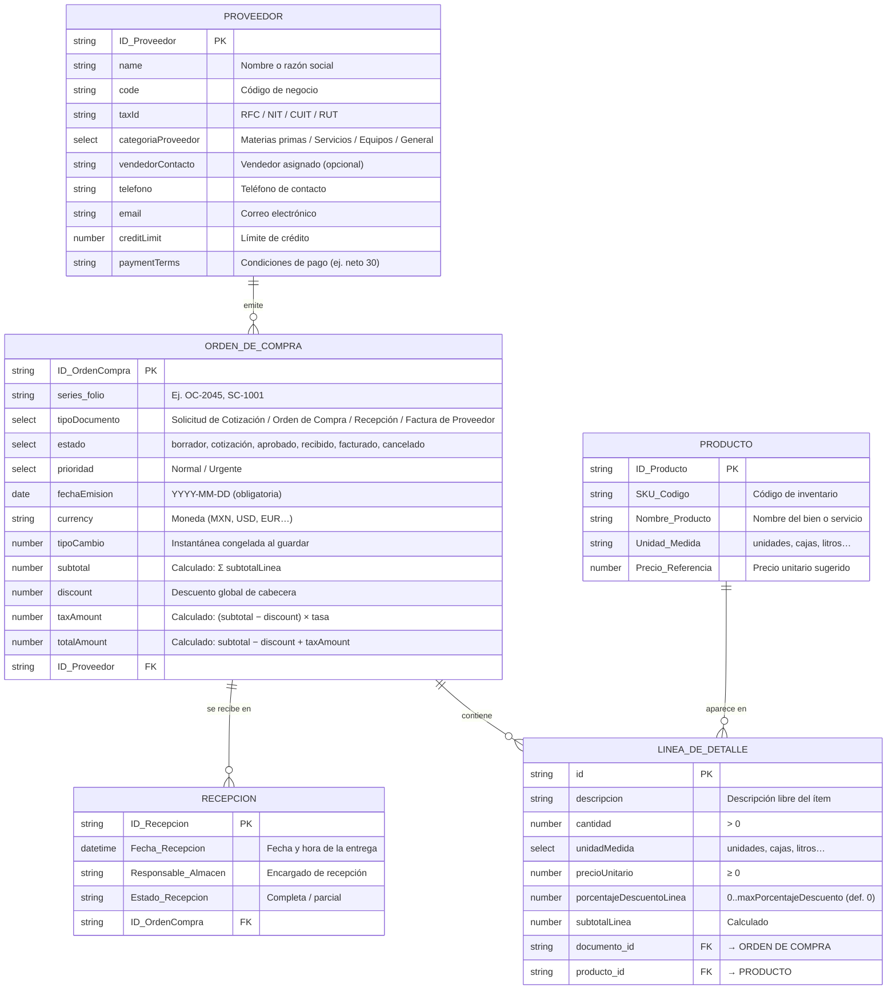
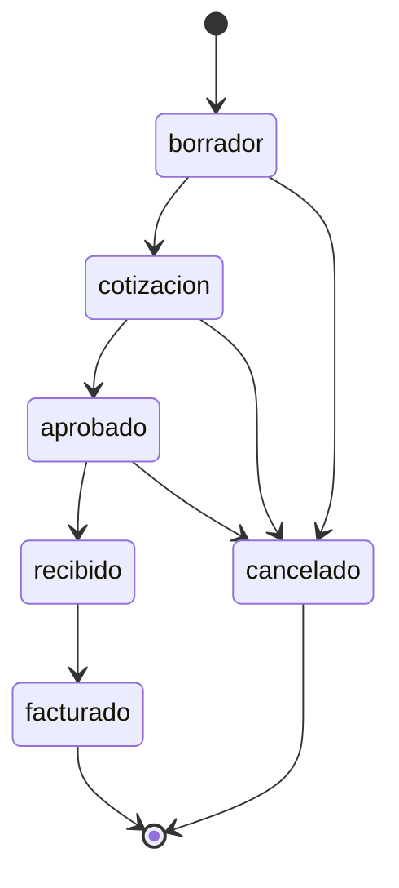

# Modelo de Datos: Módulo Adquisiciones y Compras

> **Archivo generado** por `npm run mer` (`scripts/generate-mer.js`) a partir de [`data-model.json`](data-model.json), que es la fuente única del modelo. No lo edites a mano: cambia el JSON y vuelve a generar.

Fuentes: `specs/001-erp-base-module/plan.md`, `specs/001-erp-base-module/spec.md`, `src/module-config.js`. Ante contradicciones prevalece `plan.md` (ver [Notas de reconciliación](#notas-de-reconciliación)).

### Vista rápida (Mermaid, modelo lógico)

## Entidades

Columnas: **Obligatorio** = Sí / No / Calculado (nunca lo escribe el usuario). **MER** = ✓ si el atributo se dibuja en los diagramas; los demás existen en el código pero se omiten para mantener el MER legible.

### PROVEEDOR

Dato maestro: empresa o persona que suministra bienes o servicios, con su identidad fiscal, contacto y condiciones comerciales.

*Implementación*: Entidad base (`entity`), renombrada con labels.entity = "Proveedor".

| Campo | Campo en código | Tipo | Obligatorio | PK/FK | Descripción / ejemplo | Regla de validación | MER |
|---|---|---|---|---|---|---|---|
| `ID_Proveedor` | `entity_id` | string | Sí | PK | Identificador público del proveedor; es el que referencian sus órdenes de compra. | Generado automáticamente; único entre todos los proveedores. | ✓ |
| `id` | `id` | string | Sí |  | Identificador interno del registro en el storage. | Generado automáticamente. | — |
| `name` | `name` | string | Sí |  | Nombre o razón social del proveedor. Ej./valores: Nombre o razón social | No vacío; se almacena recortado. | ✓ |
| `code` | `code` | string | Sí |  | Código o clave de negocio del proveedor. Ej./valores: Código de negocio | No vacío; se almacena recortado. | ✓ |
| `taxId` | `taxId` | string | No |  | Identificación fiscal (RFC, NIT, CUIT o RUT según el país). Ej./valores: RFC / NIT / CUIT / RUT | Opcional; se almacena recortado. | ✓ |
| `categoriaProveedor` | `categoriaProveedor` | select | Sí |  | Clasifica el tipo de suministro que aporta el proveedor (campo personalizado). Ej./valores: Materias primas / Servicios / Equipos / General | Obligatorio; uno de: Materias primas, Servicios, Equipos, General. | ✓ |
| `vendedorContacto` | `vendedorContacto` | string | No |  | Representante o vendedor asignado por el proveedor (campo personalizado). Ej./valores: Vendedor asignado (opcional) | Opcional; texto libre. | ✓ |
| `telefono` | `phone` | string | No |  | Número telefónico de contacto. Ej./valores: Teléfono de contacto | Opcional; se almacena recortado. | ✓ |
| `email` | `email` | string | No |  | Correo electrónico principal de contacto. Ej./valores: Correo electrónico | Opcional; si se informa, formato de correo válido. | ✓ |
| `creditLimit` | `creditLimit` | number | No |  | Límite de crédito otorgado por el proveedor, en la moneda configurada. Ej./valores: Límite de crédito | Opcional; número no negativo. | ✓ |
| `paymentTerms` | `paymentTerms` | string | No |  | Condiciones de pago acordadas (p. ej., contado, neto 30). Ej./valores: Condiciones de pago (ej. neto 30) | Opcional; se almacena recortado. | ✓ |
| `address` | `address` | string | No |  | Dirección fiscal o comercial. | Opcional; se almacena recortada. | — |
| `category` | `category` | string | No |  | Clasificación libre heredada de la base (la categoría de negocio es categoriaProveedor). | Opcional. | — |
| `description` | `description` | string | No |  | Descripción corta o notas. | Opcional. | — |
| `targetDate` | `targetDate` | date | No |  | Fecha objetivo genérica de la base (p. ej., revisión del proveedor). | Opcional; fecha válida YYYY-MM-DD. | — |
| `createdAt` | `createdAt` | datetime | Sí |  | Marca de tiempo de creación. | Asignada por el storage. | — |
| `updatedAt` | `updatedAt` | datetime | Sí |  | Marca de tiempo de la última actualización. | Asignada por el storage. | — |

### ORDEN DE COMPRA

Documento transaccional del flujo de compras (solicitud de cotización, orden de compra, recepción o factura de proveedor) emitido a un proveedor.

*Implementación*: Documento base (`document`), renombrado con labels.document = "Orden de Compra".

| Campo | Campo en código | Tipo | Obligatorio | PK/FK | Descripción / ejemplo | Regla de validación | MER |
|---|---|---|---|---|---|---|---|
| `ID_OrdenCompra` | `id` | string | Sí | PK | Identificador único del documento. | Generado automáticamente. | ✓ |
| `series / folio` | `series + folio` | string + integer | Sí |  | Numeración oficial: la serie agrupa folios consecutivos y se combina con el folio. Ej./valores: Ej. OC-2045, SC-1001 | series opcional; folio obligatorio, entero positivo. | ✓ |
| `tipoDocumento` | `tipoDocumento` | select | Sí |  | Etapa del flujo de compras que representa el documento (campo personalizado). Ej./valores: Solicitud de Cotización / Orden de Compra / Recepción / Factura de Proveedor | Obligatorio; uno de: Solicitud de Cotización, Orden de Compra, Recepción, Factura de Proveedor. | ✓ |
| `estado` | `status` | select | No |  | Estado del documento dentro del ciclo de vida configurado. Ej./valores: borrador, cotización, aprobado, recibido, facturado, cancelado | Uno de los estados de statusLifecycle; solo transiciones permitidas. | ✓ |
| `prioridad` | `prioridad` | select | No |  | Prioridad de la compra (campo personalizado). Ej./valores: Normal / Urgente | Opcional; Normal o Urgente. | ✓ |
| `fechaEmision` | `fechaEmision` | date | Sí |  | Día en que se creó el documento y se fijó el tipo de cambio. Ej./valores: YYYY-MM-DD (obligatoria) | Obligatoria; fecha de calendario válida YYYY-MM-DD. | ✓ |
| `currency` | `currency` | string | No |  | Código de moneda de los importes del documento. Ej./valores: Moneda (MXN, USD, EUR…) | Opcional. | ✓ |
| `tipoCambio` | `tipoCambio` | number | No |  | Valor de una unidad de la divisa del documento frente a la moneda local; no se recalcula después. Ej./valores: Instantánea congelada al guardar | Opcional; debe ser un número. | ✓ |
| `subtotal` | `subtotal` | number | Calculado |  | Importe antes de descuento global e impuestos. Ej./valores: Calculado: Σ subtotalLinea | Calculado; número no negativo. | ✓ |
| `discount` | `discount` | number | No |  | Descuento global aplicado sobre el subtotal (lo captura el usuario). Ej./valores: Descuento global de cabecera | Opcional; número no negativo, no puede superar el subtotal. | ✓ |
| `taxAmount` | `taxAmount` | number | Calculado |  | Impuesto calculado sobre la base ya descontada. Ej./valores: Calculado: (subtotal − discount) × tasa | Calculado; número no negativo. | ✓ |
| `totalAmount` | `totalAmount` | number | Calculado |  | Importe total del documento. Ej./valores: Calculado: subtotal − discount + taxAmount | Calculado; número no negativo. | ✓ |
| `startDate` | `startDate` | date | Sí |  | Fecha de inicio heredada del Documento base. | Obligatoria en el storage actual; fecha válida YYYY-MM-DD. | — |
| `endDate` | `endDate` | date | Sí |  | Fecha de fin heredada del Documento base. | Obligatoria en el storage actual; ≥ startDate. | — |
| `quantity` | `quantity` | integer | No |  | Cantidad genérica de la base (las cantidades reales viven en las líneas). | Opcional; entero positivo. | — |
| `paymentTerms` | `paymentTerms` | string | No |  | Condiciones de pago del documento. | Opcional. | — |
| `notes` | `notes` | string | No |  | Notas u observaciones libres. | Opcional. | — |
| `createdAt` | `createdAt` | datetime | Sí |  | Marca de tiempo de creación. | Asignada por el storage. | — |
| `updatedAt` | `updatedAt` | datetime | Sí |  | Marca de tiempo de la última actualización. | Asignada por el storage. | — |
| `ID_Proveedor` | `entity_id` | string | Sí | FK → PROVEEDOR.ID_Proveedor | Proveedor al que se emite el documento. | Obligatorio; debe existir en PROVEEDOR. Al eliminar el proveedor se eliminan sus documentos (cascada). | ✓ |

### RECEPCIÓN

Registro de una entrega física del proveedor contra una Orden de Compra.

*Implementación*: Registro propio asociado a la Orden de Compra (spec.md FR-044); también existe como valor "Recepción" de tipoDocumento.

| Campo | Campo en código | Tipo | Obligatorio | PK/FK | Descripción / ejemplo | Regla de validación | MER |
|---|---|---|---|---|---|---|---|
| `ID_Recepcion` | — | string | Sí | PK | Identificador único de la recepción. | Generado automáticamente. | ✓ |
| `Fecha_Recepcion` | — | datetime | Sí |  | Fecha y hora en que se registró la entrega. Ej./valores: Fecha y hora de la entrega | Obligatoria; fecha/hora válida. | ✓ |
| `Responsable_Almacen` | — | string | Sí |  | Usuario con rol de encargado de recepción que confirma la entrega. Ej./valores: Encargado de recepción | Obligatorio; solo usuarios con rol de encargado de recepción (FR-046). | ✓ |
| `Estado_Recepcion` | — | string | Sí |  | Resultado de la recepción frente a lo pendiente de la orden. Ej./valores: Completa / parcial | Obligatorio. | ✓ |
| `Observaciones` | — | string | No |  | Observaciones generales de la entrega (spec.md, entidad Recepción). | Opcional. | — |
| `ID_OrdenCompra` | — | string | Sí | FK → ORDEN DE COMPRA.ID_OrdenCompra | Orden de compra que se recibe. | Obligatorio; la orden debe existir y no estar recibida por completo, cancelada ni sin emitir (FR-047). | ✓ |

### PRODUCTO

Bien o servicio que puede comprarse.

*Implementación*: Catálogo de bienes/servicios referenciado por producto_id (aún sin colección propia en el storage).

| Campo | Campo en código | Tipo | Obligatorio | PK/FK | Descripción / ejemplo | Regla de validación | MER |
|---|---|---|---|---|---|---|---|
| `ID_Producto` | — | string | Sí | PK | Identificador único del producto. | Generado automáticamente; único. | ✓ |
| `SKU / Código` | — | string | Sí |  | SKU o código del producto; también es aceptado como producto_id en las líneas. Ej./valores: Código de inventario | Obligatorio; único. | ✓ |
| `Nombre_Producto` | — | string | Sí |  | Nombre del producto o servicio. Ej./valores: Nombre del bien o servicio | No vacío. | ✓ |
| `Unidad_Medida` | — | string | Sí |  | Unidad de medida por defecto. Ej./valores: unidades, cajas, litros… | Obligatoria; idealmente una de lineasDetalle.unidadesMedida. | ✓ |
| `Precio_Referencia` | — | number | No |  | Precio unitario de referencia para proponer precioUnitario en las líneas. Ej./valores: Precio unitario sugerido | Opcional; número no negativo. | ✓ |

### LÍNEA DE DETALLE (solo MER lógico)

Entidad intermedia que resuelve la relación N:M entre Orden de Compra y Producto (spec.md la llama Detalle_Orden).

*Implementación*: Sub-esquema LINEA_DETALLE_FIELDS en src/module-config.js (lineasDetalle del documento).

| Campo | Campo en código | Tipo | Obligatorio | PK/FK | Descripción / ejemplo | Regla de validación | MER |
|---|---|---|---|---|---|---|---|
| `id` | — | string | Sí | PK | Identificador único de la línea. | Generado automáticamente. | ✓ |
| `descripcion` | `descripcion` | string | Sí |  | Descripción libre del ítem. Ej./valores: Descripción libre del ítem | Obligatoria; no vacía. | ✓ |
| `cantidad` | `cantidad` | number | Sí |  | Cantidad solicitada. Ej./valores: > 0 | Obligatoria; número estrictamente positivo. | ✓ |
| `unidadMedida` | `unidadMedida` | select | Sí |  | Unidad de medida de la línea. Ej./valores: unidades, cajas, litros… | Obligatoria; opciones de lineasDetalle.unidadesMedida (texto libre si no se configuran). | ✓ |
| `precioUnitario` | `precioUnitario` | number | Sí |  | Precio por unidad. Ej./valores: ≥ 0 | Obligatorio; número no negativo. | ✓ |
| `porcentajeDescuentoLinea` | `porcentajeDescuentoLinea` | number | No |  | Descuento porcentual de la línea. Ej./valores: 0..maxPorcentajeDescuento (def. 0) | Opcional; 0..maxPorcentajeDescuento (def. 100); por defecto 0. | ✓ |
| `subtotalLinea` | `subtotalLinea` | number | Calculado |  | cantidad × precioUnitario × (1 − porcentajeDescuentoLinea / 100). Ej./valores: Calculado | Calculado; nunca lo escribe el usuario. | ✓ |
| `documento_id` | `documento_id` | string | Sí | FK → ORDEN DE COMPRA.ID_OrdenCompra | Documento al que pertenece la línea; la asigna el storage, no el usuario. | Asignada por el storage al persistir la línea dentro de su documento. | ✓ |
| `producto_id` | `producto_id` | string | Sí | FK → PRODUCTO.ID_Producto | Producto del catálogo (id o SKU). | Obligatorio; no vacío. | ✓ |

## Relaciones

| Origen | Destino | Cardinalidad | Participación (origen / destino) | Vista | Implementación | Descripción |
|---|---|---|---|---|---|---|
| PROVEEDOR | ORDEN DE COMPRA | 1:N | obligatoria / opcional | conceptual, lógico | FK `ID_Proveedor` en ORDEN DE COMPRA | Un proveedor puede tener muchas órdenes de compra. |
| ORDEN DE COMPRA | RECEPCIÓN | 1:N | obligatoria / opcional | conceptual, lógico | FK `ID_OrdenCompra` en RECEPCIÓN | Una orden de compra puede tener una o varias recepciones. |
| ORDEN DE COMPRA | PRODUCTO | N:M (punteada) | opcional / opcional | conceptual | Conceptual (sin FK); se resuelve con LÍNEA DE DETALLE | Relación conceptual: una orden puede incluir muchos productos y un producto puede estar en muchas órdenes. Se implementa con la entidad intermedia Línea de Detalle. |
| ORDEN DE COMPRA | LÍNEA DE DETALLE | 1:N | obligatoria / opcional | lógico | FK `documento_id` en LÍNEA DE DETALLE | Una orden tiene cero o muchas líneas de detalle. |
| PRODUCTO | LÍNEA DE DETALLE | 1:N | obligatoria / opcional | lógico | FK `producto_id` en LÍNEA DE DETALLE | Un producto puede aparecer en muchas líneas. |

Integridad referencial: al eliminar un PROVEEDOR se eliminan los documentos que referencian su `entity_id` (cascada del storage). Las líneas de detalle viven dentro de su documento y desaparecen con él.

## Ciclo de vida de estados (ORDEN DE COMPRA.estado)

| Estado actual | Transiciones permitidas |
|---|---|
| borrador | cotización, cancelado |
| cotización | aprobado, cancelado |
| aprobado | recibido, cancelado |
| recibido | facturado |
| facturado | *(fin)* |
| cancelado | *(fin)* |

El flujo avanza solicitud de cotización (cotización) → orden aprobada (aprobado) → recepción de mercancía (recibido) → factura de proveedor registrada (facturado). La cancelación se permite mientras la recepción no se haya confirmado.

## Fórmulas de totales

| Campo | Fórmula | Helper (`src/module-config.js`) |
|---|---|---|
| `subtotalLinea` | `subtotalLinea = cantidad × precioUnitario × (1 − porcentajeDescuentoLinea / 100)` | `computeSubtotalLinea` |
| `subtotal` | `subtotal = Σ subtotalLinea` | `subtotalFromLineas` |
| `taxAmount` | `taxAmount = (subtotal − discount) × tasaImpuesto` | `applyTotalesToCabecera` |
| `totalAmount` | `totalAmount = subtotal − discount + taxAmount` | `applyTotalesToCabecera` |

Todos los importes se redondean a 2 decimales. tasaImpuesto es una fracción (p. ej., 0.19 para 19 %). El porcentaje de descuento de línea se acota a 0..100 antes de aplicarse. Cualquier cambio en las líneas recalcula en cascada los totales de la cabecera.

## Configuración del módulo (ModuleConfig)

Objeto ModuleConfig (`userConfig` en src/module-config.js) cargado al arrancar que adapta el módulo base al módulo Adquisiciones y Compras.

| Campo | Tipo | Descripción | Restricciones |
|---|---|---|---|
| `moduleName` | string | Nombre visible del módulo ("Adquisiciones y Compras"). | Obligatorio, no vacío. |
| `labels` | object | Términos: entity → Proveedor, document → Orden de Compra (y sus plurales). | Opcional; retrocede a Entidad/Documento. |
| `customFields` | array | Campos personalizados `{ target, key, label, type, required, options? }` (categoriaProveedor, vendedorContacto, tipoDocumento, prioridad, tipoCambio, fechaEmision). | Las claves no deben chocar con campos base. |
| `statusLifecycle` | object | Estados y transiciones permitidas de los documentos (ver ciclo de vida). | Opcional; los estados de transitions deben existir en statuses. |
| `lineasDetalle` | object | Configuración de las líneas: label, unidadesMedida, maxPorcentajeDescuento, camposExtra. | Opcional; maxPorcentajeDescuento entre 0 y 100; camposExtra no chocan con LINEA_DETALLE_FIELDS. |
| `theme` | object | Marca; accentColor = #0f766e. | accentColor debe ser hexadecimal #rgb o #rrggbb. |

- La configuración se carga una vez al arrancar y se aplica en todas las pantallas.
- Sin configuración se usan los valores integrados: Entidad/Documento, sin campos personalizados, estado de texto libre y color de acento predeterminado.
- Los valores inválidos o conflictivos se informan con claridad en lugar de fallar en silencio.
- Los valores de campos personalizados se persisten junto a los campos base sin cambios de esquema en el storage.
- Un ciclo de vida configurado reemplaza la entrada de estado de texto libre.

## Notas de reconciliación

1. **tipoDocumento incluye «Recepción».** La imagen de referencia omite «Recepción» entre las opciones de tipoDocumento. plan.md y module-config.js la incluyen (Solicitud de Cotización / Orden de Compra / Recepción / Factura de Proveedor); prevalece plan.md.
2. **RECEPCIÓN como entidad y como tipoDocumento.** plan.md trata la recepción como un tipoDocumento del Documento base, mientras que spec.md (HU6, FR-044) exige guardar cada recepción como registro propio asociado a la Orden de Compra, sin sobrescribir las anteriores. El MER modela RECEPCIÓN como entidad propia (1:N desde ORDEN DE COMPRA) porque una orden puede recibirse en varias entregas parciales. Mientras no exista una colección propia, un documento con tipoDocumento = «Recepción» vinculado al mismo proveedor actúa como su implementación; ID_OrdenCompra es la FK que lo une a la orden de origen.
3. **Campos añadidos que faltaban en la imagen.** discount, tipoCambio y fechaEmision no aparecían en la imagen y se añaden porque existen en plan.md / module-config.js.
4. **discount no es calculado.** El encargo pedía marcar subtotal, discount, taxAmount y totalAmount como calculados. Según plan.md y applyTotalesToCabecera, discount es el descuento global que captura el usuario y se aplica después de Σ subtotalLinea; solo subtotal, taxAmount y totalAmount son calculados.
5. **Ortografía de categoriaProveedor.** La imagen dice «Materias primes»; lo correcto (y lo que usa module-config.js) es «Materias primas».
6. **Nombres lógicos frente a campos de código.** ID_Proveedor corresponde a entity_id (identificador público al que apuntan los documentos; el storage también guarda un id interno), ID_OrdenCompra corresponde a document.id, telefono corresponde a phone y estado corresponde a status. La columna «Campo en código» de cada tabla da la correspondencia.
7. **taxId.** El encargo indica RFC / NIT / RUT; plan.md indica RFC/NIT/CUIT. Se documentan los cuatro, ya que el campo es texto libre.
8. **PK de la Línea de Detalle.** LINEA_DETALLE_FIELDS no declara un campo id: hoy la línea se identifica por su posición dentro de documento.lineasDetalle. El MER lógico declara la PK id como requisito para persistirla como entidad intermedia; el storage aún no la genera.
9. **PRODUCTO sin catálogo implementado.** plan.md solo define producto_id como «referencia al catálogo de bienes/servicios (id o SKU)», de tipo texto y sin validación referencial. PRODUCTO y sus atributos (SKU / Código, Nombre_Producto, Unidad_Medida, Precio_Referencia) son el catálogo conceptual al que apunta esa referencia; la FK producto_id → ID_Producto es lógica y el storage todavía no la valida.
10. **lineasDetalle no está activo en userConfig.** El bloque lineasDetalle solo aparece en el comentario de ejemplo de module-config.js; el perfil activo no lo declara, por lo que se usan los valores por defecto (sin unidadesMedida, maxPorcentajeDescuento = 100) y unidadMedida se captura como texto.
11. **Fechas base del Documento.** El storage actual sigue exigiendo startDate y endDate (endDate ≥ startDate) además de fechaEmision. Se documentan como obligatorias, pero no se muestran en el MER.
12. **Estados en spec.md.** spec.md (HU2/HU6) menciona estados Emitida, Recibida parcialmente, Recibida y Pagada, que no coinciden con el ciclo de vida de plan.md/module-config.js. Prevalece plan.md; «recibida parcialmente» se refleja en Estado_Recepcion (Completa / parcial) y no en estado de la orden.
13. **Nombre de la tabla intermedia.** spec.md (HU2) llama Detalle_Orden a la tabla intermedia; en el modelo se llama LÍNEA DE DETALLE, como en plan.md y LINEA_DETALLE_FIELDS.
14. **Línea de Recepción.** spec.md describe una Línea de Recepción (cantidad conforme, rechazada y motivo). Queda fuera de este MER, que se limita a las entidades pedidas; es la siguiente extensión natural de RECEPCIÓN (1:N).
